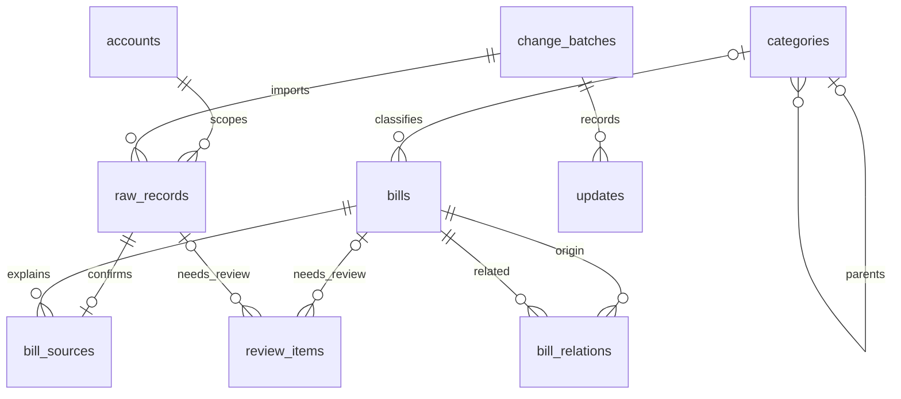

# 数据库 schema spec

状态：v0.2，本地导入阶段。已实现九张表的首版迁移、约束、审计和导入命令；UI、跨平台自动关联及消费分类尚未实现。可执行定义见 [schema.sql](../accounting/schema.sql)，审计及事务协议见 [database.py](../accounting/database.py)。

## 1. 目标与已确定的边界

- SQLite 保存本地数据，本地服务提供浏览器 UI。
- 首次分析区间为 2026-01-01 至 2026-09-30，使用本地日期的左闭右开条件 `>= 2026-01-01 AND < 2026-10-01`。
- 数据来源为支付宝 CSV、微信 XLSX、美团 CSV 和工商银行借记账户 PDF。美国银行信用卡不在范围内。
- 导入完整文件，不先截断支付时间。区间外的付款也可能对应区间内的使用日期。
- 使用日期仅由本人指定；未指定时按支付日期展示。AI 不推断活动日期。
- 年卡、多次课暂按单笔记录；首版不引入月度摊销、按次核销或通用拆单系统。
- 消费必须有具体分类，可以仅选大类，也可以选其小类；不设置“其他”。待核对是处理状态。
- 有充分证据的 AI 修正自动落库；有歧义的判断留待本人处理。人工确认的分类不得被 AI 覆盖。

本设计的统一 `bills` 保存整理后的经济事件，包含消费、退款、归还垫付、收入及非消费资金行为。生活消费报表只读取其中符合条件的消费，不能把全部出账相加。

## 2. 模型与表的职责



| 表 | 职责 |
| --- | --- |
| `accounts` | 来源账户及资金账户的本地标识 |
| `raw_records` | 不可变的来源记录快照 |
| `categories` | 两级可自定义消费分类 |
| `bills` | 统一事件、日期、个人承担额、分类和处理状态 |
| `bill_sources` | 已确认的来源关联，避免跨平台重复计算 |
| `bill_relations` | 退款、归还垫付、内部转账和还款的金额关联 |
| `review_items` | 需要人工判断的问题、建议和证据 |
| `change_batches` | 一次原子操作的操作者及目的 |
| `updates` | 追加保存的逐条修改历史 |

首版不维护通用复式账本或完整账户余额账。银行余额用于验证导入和辅助匹配，不从 `bills` 反推所有账户的余额。

## 3. 通用存储约定

- 除 `updates.id` 外，主键均为应用生成的 UUID 文本。ID 一经使用不复用。
- 金额均为整数“分”。`amount_cents` 是非负绝对值，方向单独保存；禁止经过浮点数转换金额。
- 首版只汇总人民币。来源出现其他币种时保留原币种并待核对，不隐式按人民币计算或自动换汇。
- 平台订单号、交易号、账号必须使用文本，不得转换为数字。来源中已损坏或科学计数法表示的标识不能臆测恢复。
- 事件时间存为 UTC 的 ISO 8601 文本，如 `2026-01-01T04:30:00Z`。原始字符串保留在来源快照。
- 生活日期使用 `YYYY-MM-DD`，统计时区固定为 `Asia/Shanghai`（UTC+08:00）。使用日期是日期，不是 UTC 午夜时间戳。
- `created_at`、`updated_at` 和审计时间均为 UTC。新建业务行 `revision = 1`，每次实际修改递增。
- 表采用 `STRICT`，JSON 保存为带 `json_valid(...)` 约束的 `TEXT`。应用启动时验证 SQLite >= 3.38.0 且 JSON 函数可用。
- 每个数据库连接在事务开始前执行并核验 `PRAGMA foreign_keys = ON`，不得依赖默认设置。
- 时间和日期的严格格式、真实日历日期、枚举、金额范围均需验证。仅检查文本长度不等于日期有效。
- 外键默认 `ON DELETE RESTRICT`。历史记录不得因删除业务对象而级联消失。
- 下文 `?` 表示允许 NULL；其余字段均 NOT NULL。`JSON` 表示受约束的 JSON 文本。

## 4. 各表字段与约束

### 4.1 accounts

来源账户可以是钱包、借记账户或购物平台账户；“来源平台”和“资金账户类型”分别表达。例如美团账户的记录可以由另一资金账户付款。

| 字段 | 类型 | 含义 |
| --- | --- | --- |
| `id` | TEXT PK | 本地账户 ID |
| `provider` | TEXT | `alipay / wechat / meituan / icbc / manual` |
| `account_kind` | TEXT | `wallet / bank_debit / platform / credit / cash` |
| `display_name` | TEXT | 本人填写的昵称 |
| `external_ref` | TEXT? | 本地保存的来源账户标识；允许无标识的平台账户 |
| `currency` | TEXT | 默认 CNY |
| `is_active` | INTEGER | 0 或 1 |
| `created_at`、`updated_at` | TEXT | 时间 |
| `revision` | INTEGER | 版本 |

同一来源账户的标识在有值时唯一：`UNIQUE(provider, external_ref) WHERE external_ref IS NOT NULL`。空白标识存 NULL。账户停用不删除历史；付款方式中的优惠券或补贴不是单独的本人资金账户。

### 4.2 raw_records

| 字段 | 类型 | 含义 |
| --- | --- | --- |
| `id` | TEXT PK | 来源快照 ID |
| `account_id` | TEXT FK | → accounts；来源身份范围 |
| `source_event_key` | TEXT | 来源内的事件身份，见去重规则 |
| `snapshot_sha256` | TEXT | 原始载荷的确定性哈希 |
| `transaction_id`、`merchant_order_id` | TEXT? | 来源交易号及商家订单号 |
| `occurred_at` | TEXT? | 解析后的 UTC 事件时间 |
| `time_precision` | TEXT | `second / minute / day / unknown` |
| `amount_cents` | INTEGER? | 来源实际收付金额；解析失败时 NULL |
| `currency` | TEXT? | 来源币种 |
| `direction` | TEXT | `outflow / inflow / none / unknown` |
| `original_category` | TEXT? | 平台原分类 |
| `description`、`counterparty` | TEXT? | 来源商品说明、对方名称 |
| `original_status` | TEXT? | 来源状态原文 |
| `raw_payload_json` | JSON | 完整来源字段和值，不做覆盖修正 |
| `source_filename` | TEXT | 首次发现此快照的文件名 |
| `source_file_sha256` | TEXT | 该原文件字节的 SHA-256 |
| `source_locator_json` | JSON | CSV 起止行、XLSX sheet/行，或 PDF 页/行 |
| `parser_version` | TEXT | 解析版本 |
| `import_batch_id` | TEXT FK | → change_batches；首次导入批次 |
| `created_at` | TEXT | 首次发现时间 |

唯一键为 `(account_id, source_event_key, snapshot_sha256)`。同一事件有不同状态或载荷时保存多个不可变快照，不能把新快照当作新消费。

载荷须保留原始列顺序、重复或空列名及原值，例如保存 `headers` 与 `values` 数组；不能因 JSON 对象键重名而丢列。PDF 载荷保留抽取的原始单元格，由 source_filename、source_file_sha256 与 source_locator_json 追溯原文件。snapshot_sha256 覆盖载荷和解析版本，允许修复解析器后保留新快照。

不再建立 import_files 或 import_rows。完全重复的快照仅保留首次来源位置；后续文件中的重复出现计入本地导入报告，不额外建立来源行关联。每次报告保存各文件哈希、行数、校验细节、新增及跳过数量，位于忽略目录 data/，不进入公开仓库。

原始快照只允许新增，不允许 UPDATE 或普通 DELETE；重新解析、AI 修正及人工修正都不能改写它。

### 4.3 categories

| 字段 | 类型 | 含义 |
| --- | --- | --- |
| `id` | TEXT PK | 稳定分类 ID |
| `parent_id` | TEXT FK? | → categories；NULL 表示大类 |
| `name` | TEXT | 分类名称 |
| `sort_order` | INTEGER | UI 顺序 |
| `is_active` | INTEGER | 0 或 1 |
| `created_at`、`updated_at` | TEXT | 时间 |
| `revision` | INTEGER | 版本 |

最多两级，禁止循环和自引用。小类的父节点必须是大类；有子类的节点不能改成小类。大类也可以直接被账单选择。

规范化空白后，同级名称唯一。使用两个部分唯一索引分别约束根节点名称及 `(parent_id, name)`，避免 SQLite 的 NULL 唯一性语义放过重复根节点。禁止空名及“其他／其它／Other”等兜底名称；待核对不建为分类。

停用分类不破坏历史引用。被引用的分类只能停用，或在同一有审计的事务中迁移引用后删除。AI 可选择现有分类，新增或调整分类树由本人决定。改名、调整父节点、合并及停用都留审计记录。

### 4.4 bills

| 字段 | 类型 | 含义 |
| --- | --- | --- |
| `id` | TEXT PK | 统一事件 ID |
| `entry_origin` | TEXT | `imported / manual` |
| `kind` | TEXT | 事件性质，见下表 |
| `payment_status` | TEXT | `settled / pending / voided` |
| `direction` | TEXT | `outflow / inflow / none` |
| `amount_cents` | INTEGER | 此事件的实际收付金额，非负 |
| `currency` | TEXT | 首版参与生活统计时必须 CNY |
| `paid_at` | TEXT | UTC 事件时间；退款等表示该事件自身发生时间 |
| `time_precision` | TEXT | `second / minute / day` |
| `payment_account_id` | TEXT FK? | → accounts；可确认的资金来源账户 |
| `usage_date` | TEXT? | 仅本人指定的使用日期；NULL 表示未指定 |
| `description`、`counterparty` | TEXT? | 用于展示的商品及对方信息 |
| `category_id` | TEXT FK? | → categories；仅消费适用 |
| `personal_base_cents` | INTEGER? | 消费中本人应承担的原始份额，退款前 |
| `review_status` | TEXT | `pending / auto_confirmed / user_confirmed` |
| `classification_locked` | INTEGER | 0 或 1；保护人工确认的性质、分类和承担份额 |
| `inclusion_status` | TEXT | `included / excluded` |
| `exclusion_reason` | TEXT? | 排除原因 |
| `notes` | TEXT? | 本人备注 |
| `merged_into_bill_id` | TEXT FK? | → bills；重复事件归并后的存续 ID |
| `deleted_at` | TEXT? | 软删除时间 |
| `created_at`、`updated_at` | TEXT | 时间 |
| `revision` | INTEGER | 用于并发和建议过期检查 |

| kind | 含义 | 进入个人消费 |
| --- | --- | --- |
| `expense` | 商品或服务消费，含代垫及共同消费 | 仅本人承担的净额 |
| `income` | 真正收入，如利息 | 否 |
| `refund` | 购买退款 | 通过关系调整原消费 |
| `reimbursement` | 他人归还代垫款 | 否，不重复扣减消费 |
| `internal_transfer` | 本人账户间转账、充值、提现 | 否 |
| `debt_repayment` | 已记消费对应的债务本金偿还 | 否 |
| `investment` | 投资本金买入、赎回等 | 否 |
| `pending` | 性质未明确 | 待核对，不能伪装成已分类消费 |

必要约束：

1. 已确认的 expense 必须 `amount_cents > 0`、方向 outflow、分类非 NULL、`0 <= personal_base_cents <= amount_cents`。不确定份额时保持 pending，不能用 NULL 当作 0。
2. 非 expense 的 category_id 和 personal_base_cents 为 NULL。refund、reimbursement、income 的方向为 inflow，debt_repayment 为 outflow；internal_transfer、investment 根据事件确定方向。
3. `kind = pending` 不能标记为已确认。category_id 有值时必须引用有效存在的分类；新选择不得使用已停用分类，已有引用不失效。
4. `inclusion_status = excluded` 必须有非空 exclusion_reason；included 时该字段为 NULL。
5. merged_into_bill_id 不得指向自己或形成循环，归并对象必须软删除。归并须迁移来源和关系并保留原 ID 的历史。
6. 用户确认性质、分类或承担份额后设置 classification_locked。只有用户操作可以解锁；AI 不能通过改状态绕过锁。
7. usage_date 不由 AI 写入。更正 paid_at 时，人工指定的 usage_date 保持不变。
8. 已支付后发生退款的原消费仍为 settled。不能既标记 voided 又扣除退款，否则会漏记或重复冲减。
9. usage_date 仅对 expense 适用，其他事件保持 NULL；非消费事件始终使用自身的 paid_at 解释资金发生时间。

`effective_usage_date` 是视图字段，不在 bills 再存一份：

```sql
COALESCE(usage_date, date(paid_at, '+8 hours'))
```

UI 的日期来源也派生为 `manual` 或 `payment_default`。这样修改支付时间时，默认日期会随之更新，而人工日期不会被覆盖。

### 4.5 bill_sources

此表仅保存已经确认的关联。金额统计不对本表求和。

| 字段 | 类型 | 含义 |
| --- | --- | --- |
| `id` | TEXT PK | 关联 ID |
| `bill_id` | TEXT FK | → bills |
| `raw_record_id` | TEXT FK UNIQUE | → raw_records |
| `role` | TEXT | `order / payment / funding / snapshot` |
| `is_primary` | INTEGER | 0 或 1；初始事实采用的主要来源 |
| `match_method` | TEXT | `exact_id / composite / manual` |
| `evidence_json` | JSON | 关联依据、字段比较和相关来源 ID |
| `created_at` | TEXT | 确认时间 |

每个原始快照至多关联一个存续 bill；同一来源事件的多个快照必须归入同一 bill。每个已完成导入的 bill 恰有一个 primary source，通过部分唯一索引保证至多一个，通过提交前校验保证至少一个；手工 bill 可以没有来源。

主要来源确定初始金额和时间，其他来源补充订单内容或佐证资金路径。购物金额、平台实付金额和银行卡扣款不相等时不能任意挑选，需解释优惠、退款或时间差；不能解释就待核对。

首版不把一条合并付款复制到多个消费。遇到合单付款或一笔付款包含不同性质的组成部分，保留原记录并待核对，后续通过明确的拆分功能处理。

### 4.6 bill_relations

| 字段 | 类型 | 含义 |
| --- | --- | --- |
| `id` | TEXT PK | 关系 ID |
| `origin_bill_id` | TEXT FK | → bills；原消费或转出事件 |
| `related_bill_id` | TEXT FK | → bills；退款、归还、转入或还款事件 |
| `relation_type` | TEXT | `refund / reimbursement / internal_transfer / repayment` |
| `amount_cents` | INTEGER | 此次对应金额，严格大于 0 |
| `personal_refund_cents` | INTEGER? | 仅 refund：其中属于本人的退款 |
| `created_at`、`updated_at` | TEXT | 时间 |
| `revision` | INTEGER | 版本 |

`UNIQUE(origin_bill_id, related_bill_id, relation_type)`，禁止自关联。所有关联使用同一币种，双方必须已确认、settled、included 且未删除。refund 的 personal_refund_cents 必须非 NULL；其他关系该字段必须为 NULL。按金额支持多笔归还对应一笔支出、一笔归还对应多笔支出和部分退款。

跨行约束必须同时作用于关系新增、修改，以及相关 bill 的金额、性质、状态修改，不能只在插入关系时检查：

- refund：origin 为 settled expense，related 为 settled refund。全部关系分配额不得超过退款事件金额或原消费金额；`0 <= personal_refund_cents <= amount_cents`。累计个人退款不得超过 personal_base_cents，累计非个人退款不得超过 `amount_cents - personal_base_cents`。
- reimbursement：origin 为 expense，related 为 reimbursement。归还额合计不得超过归还事件金额，也不得超过原消费的他人承担额扣除其退款后的余额。
- internal_transfer：origin 为本人的转出，related 为本人的转入；双方均 internal_transfer，分配额不能超过各自金额。收取的手续费应作为独立消费，不能猜测差额性质。
- repayment：origin 为先前记录的消费，related 为 debt_repayment；不能超过该还款事件金额或对应消费尚未匹配的本金。还款不新增消费，手续费或利息不能默认为本金。

跨行金额上限由数据库触发器保障，并由应用在同一事务结束前检查完整性。尚不能确定分配关系的退款、归还和还款保留为待核对，禁止猜配。相关 bill 删除或排除之前，必须显式处理会受影响的关系，并在同一批次留下记录。

### 4.7 review_items

| 字段 | 类型 | 含义 |
| --- | --- | --- |
| `id` | TEXT PK | 待核对问题 ID |
| `bill_id` | TEXT FK? | → bills |
| `raw_record_id` | TEXT FK? | → raw_records |
| `topic` | TEXT | `nature / category / matching / personal_share / refund_allocation / parsing / duplicate` |
| `status` | TEXT | `open / resolved / dismissed` |
| `reason` | TEXT | 具体歧义或缺失信息 |
| `proposal_json` | JSON? | 建议值或关联候选，不代表已生效 |
| `evidence_json` | JSON | 原始记录及支持材料 |
| `bill_revision` | INTEGER? | 生成建议时的 bill 版本 |
| `resolved_batch_id` | TEXT FK? | → change_batches |
| `created_at`、`updated_at` | TEXT | 时间 |
| `revision` | INTEGER | 版本 |

bill_id 与 raw_record_id 至少一个非 NULL。候选关系只保存在建议中，不进入 confirmed bill_sources。应用建议前比较 bill_revision，过期建议必须重新检查，不能覆盖后来的人工修改。

未填写使用日期是可筛选的 UI 状态，不强制为每笔默认日期创建待核对问题。解决或驳回问题时必须设置 resolved_batch_id，相关账单修改与关闭问题在同一事务完成。

### 4.8 change_batches

| 字段 | 类型 | 含义 |
| --- | --- | --- |
| `id` | TEXT PK | 一次原子业务操作 ID |
| `actor_type` | TEXT | `user / ai / importer / system` |
| `actor_label` | TEXT | 操作者或程序标识 |
| `model_id` | TEXT? | AI 模型标识，如适用 |
| `reason` | TEXT | 批次目的 |
| `undo_of_batch_id` | TEXT FK? | → change_batches；撤销哪个批次 |
| `created_at` | TEXT | 创建时间 |

批次和所有实际修改在一个事务内提交。失败时整批回滚，包括 updates；审计记录表示成功提交的变化，操作失败另记本地运行日志。批次一旦提交不可改写或删除。

批次理由可以描述任务，但不能代替逐笔修改理由。不同账单的分类修正必须分别留下证据。

### 4.9 updates

| 字段 | 类型 | 含义 |
| --- | --- | --- |
| `id` | INTEGER PK AUTOINCREMENT | 审计顺序 ID |
| `batch_id` | TEXT FK | → change_batches |
| `entity_table` | TEXT | 被修改的业务表 |
| `entity_id` | TEXT | 被修改对象的稳定 ID |
| `operation` | TEXT | `insert / update / delete` |
| `before_json` | JSON? | 完整修改前快照 |
| `after_json` | JSON? | 完整修改后快照 |
| `reason` | TEXT | 此条修改的可核查理由 |
| `evidence_json` | JSON | 来源记录、关系、用户输入等证据 |
| `created_at` | TEXT | 变更时间 |

entity_id 故意不设指向业务表的外键，防止删除对象时丢失日志。insert 的 before 为 NULL，delete 的 after 为 NULL，update 两者均非 NULL。审计快照保留当时的分类名称和路径，不能只依靠后来可能改名的 category_id 解释历史。

updates 只允许触发器追加，不允许普通 UPDATE 或 DELETE。它记录本地应用操作，不能宣称能够阻止拥有数据库文件控制权的人改写数据库文件。

## 5. 导入、去重与跨平台匹配

### 同源去重

1. 文件字节哈希用于追溯，不依赖独立文件表去重。每次先完整解析及校验，再通过来源账户、事件身份与快照哈希去重。
2. 可靠来源事件 ID 必须带来源账户范围和事件类型，不能把消费和退款因共享订单号而合并。商家订单号不等于全局唯一支付事件。
3. 若来源没有可靠事件 ID，使用时间精度、方向、金额、对方、描述、可用余额等构成来源指纹。相同指纹的多次出现按多重集合对齐，不能用“同金额同时间”直接消除真实的重复购买。
4. 银行的序号、行号或 PDF 页码不能直接当跨文件稳定交易 ID。不能可靠对齐时保留原记录并进入 duplicate 核对。
5. 同一事件的新快照只增加来源证据；重新导入不得复活已排除或软删除的 bill，也不得覆盖人工日期、分类和锁。

### 跨平台匹配

“美团订单 → 微信付款 → 银行扣款”是同一消费的多份证据。只有 bill 参与消费汇总，来源关联数量不改变金额。

优先比较已验证含义的事件 ID；没有直接关联标识时，综合实际收付金额、币种、时间窗口及精度、资金渠道和商品信息。分钟级记录不能伪装成秒级精确匹配。只凭金额相同、同一天或同一商户不足以自动确认；多个合理候选进入 review_items。

银行卡独有消费形成独立 bill。已在钱包或支付平台记录的消费所对应扣款，只补充 funding 来源。充值、提现和本人账户内部移动建立 internal_transfer；不能当收入或额外消费。

美团月付等先消费后偿还的情况：购买时形成 expense，之后本金偿还形成 debt_repayment，不把后来的银行卡还款作为原购买的重复 funding 或第二笔消费。尚未找到对应本金关系时留待核对。

### 来源字段映射

| 来源 | 初始支付/事件时间 | 金额依据 | 分类与内容证据 |
| --- | --- | --- | --- |
| 支付宝 | 交易时间 | 金额及收/支方向 | 原交易分类、商品说明、交易对方、状态、两类订单标识 |
| 微信 | 交易时间 | 金额及收/支方向 | 商品、交易类型、对方、当前状态、支付方式、两类单号 |
| 美团 | 成功时间优先；创建时间作为补充并保留差异 | 实付金额；订单金额仅作订单证据 | 订单标题、交易类型、支付方式、单号、备注 |
| 工商银行 | 交易日期和时间 | 带符号的收入/支出金额 | 摘要、对方、渠道、余额；保留 PDF 页与行定位 |

“成功时间”必须先判断是付款还是退款等事件的成功时间。平台交易关闭、全额退款等状态不能直接映射成零支出或普通收入，必须结合来源事实。PDF 去除水印干扰后，逐页核对笔数、收支合计及相邻余额；缺失、不一致的结果不能标记校验通过。

## 6. 个人消费与垫付结算的计算

对一笔已确认、settled、included、未删除的 expense：

```text
本人净消费 = personal_base_cents - 已确认且有效的个人退款合计
他人应归还余额 = amount_cents - personal_base_cents
                 - 非个人退款合计 - 已对应的归还金额合计
```

personal_base_cents 表示退款前的本人份额。正常个人消费默认全额；确认替别人垫付时为 0；共同消费可以指定本人份额。给他人购买但由本人最终承担的礼物仍是个人消费，不能仅因收款人为朋友就自动认定为垫付。

归还垫付不再从本人净消费减一次。退款、归还的实际到账日期保留，但生活消费调整归属于原消费的 effective_usage_date；现金流发生日期仍是退款或归还自身的 paid_at。

下面查询已由迁移中的 personal_expenses 视图实现同等口径。此查询仅返回已确认消费，不能被 UI 当作“所有数据已完整核对”的证明。

```sql
WITH personal_refunds AS (
    SELECT
        relation.origin_bill_id,
        SUM(relation.personal_refund_cents) AS refunded_cents
    FROM bill_relations AS relation
    JOIN bills AS refund ON refund.id = relation.related_bill_id
    WHERE relation.relation_type = 'refund'
      AND refund.kind = 'refund'
      AND refund.payment_status = 'settled'
      AND refund.review_status IN ('auto_confirmed', 'user_confirmed')
      AND refund.inclusion_status = 'included'
      AND refund.deleted_at IS NULL
    GROUP BY relation.origin_bill_id
),
personal_expenses AS (
    SELECT
        bill.id,
        bill.category_id,
        COALESCE(bill.usage_date, date(bill.paid_at, '+8 hours')) AS effective_usage_date,
        bill.personal_base_cents - COALESCE(refund.refunded_cents, 0) AS personal_net_cents
    FROM bills AS bill
    LEFT JOIN personal_refunds AS refund ON refund.origin_bill_id = bill.id
    WHERE bill.kind = 'expense'
      AND bill.payment_status = 'settled'
      AND bill.review_status IN ('auto_confirmed', 'user_confirmed')
      AND bill.inclusion_status = 'included'
      AND bill.deleted_at IS NULL
      AND bill.currency = 'CNY'
)
SELECT *
FROM personal_expenses
WHERE effective_usage_date >= '2026-01-01'
  AND effective_usage_date < '2026-10-01';
```

报表须同时显示尚未解析、未关联、待确认性质/分类的记录数量，以及日期默认/人工填写的覆盖情况。待核对流水金额可能含跨平台重复或非消费，不能直接加到已确认消费得出“完整总额”。全额退款和垫付的零净额记录仍可在明细中检查。

## 7. AI 修改与审计写入协议

所有可变业务表（accounts、categories、bills、bill_sources、bill_relations、review_items）的新增、实际修改和删除均通过常驻数据库触发器记录。raw_records 以不可变来源、内嵌文件定位及导入批次追溯，不覆盖历史。

写入协议：

1. 应用对每个写连接注册 `audit_batch_id()`、`audit_reason()`、`audit_evidence_json()` 等连接级函数，默认返回空上下文。
2. 在事务中创建 change_batches，并设置当前批次、此条操作的理由和证据。不同修改可使用不同的逐条理由。
3. BEFORE 触发器校验上下文存在、批次存在且理由非空；AFTER 触发器读取 OLD/NEW 生成完整快照并 INSERT updates。缺少函数或上下文时写入失败，不能默默跳过审计。
4. 比较业务字段时用 NULL 安全的 `IS NOT`。仅更新技术时间或将字段赋为相同值，不制造虚假业务修改日志。
5. 成功提交或失败回滚后，在 finally 中清空连接上下文。连接池复用不得继承前一操作的身份或理由。
6. AI 操作须验证分类锁、建议生成时的版本、来源证据和允许修改的字段。使用日期由用户填写，AI 不得修改；审计不能代替这些业务约束。

审计通过数据库触发器实现；理由和证据由应用明确提供，SQLite 不负责推断操作者或理由。当前迁移为上述六张可变业务表生成完整行快照，并保留分类名称和路径；不只记录 category_id。

撤销创建新的 change_batch，并以新操作记录反向变化，不改写旧日志。撤销前比较当前对象是否仍等于目标批次的修改后状态；存在后续变化时交由本人核对，不能用整行旧快照覆盖后来的修改。

对一次匹配归并、退款分配或批量分类，业务变化、问题状态及审计必须同一事务成功或失败。触发器失败时应用必须回滚整批事务，不能只忽略失败的语句后继续提交。

## 8. 排除、删除、恢复与归并

- 排除统计通过 inclusion_status 与理由实现；原记录、资金关系和操作证据保留。
- 默认删除设置 deleted_at。恢复清空 deleted_at，也产生新审计记录；恢复不改变已有分类或使用日期。
- 退款、归还或本金关联的对象不能静默删除。先显示影响，并在同一批次明确调整或移除相关关系。
- 同一消费误建成两个 bill 时，选择存续 bill，迁移来源和关系，检查金额上限与唯一性，再软删除被归并对象并设置 merged_into_bill_id。保留双方历史；有冲突的人工结果不能自动择一覆盖。
- 普通重新导入不能复活软删除、排除或被归并的对象。导入器应通过来源事件身份找到已有处理决定。
- 永久清除（尤其原始载荷、PDF、备份及审计快照中的个人信息）不属于普通删除。后续必须单独规定操作范围；不能声称删除 bills 一行就已彻底删除个人数据。

## 9. 约束、索引与迁移要求

数据库层负责：PK/FK、枚举、非负整数金额、适用字段的 NULL 规则、唯一性、JSON 有效性、分类树约束、跨行金额上限、不可变来源保护及审计触发器。应用层还负责日期严格验证、来源语义、匹配证据、人工锁、版本检查及事务提交前完整性检查。

建议索引：

- raw_records：来源唯一键，以及 `(account_id, transaction_id)`、`(account_id, merchant_order_id)`、`(amount_cents, occurred_at)`。
- bills：`(paid_at)`、`(usage_date)`、`(category_id)`，及按未删除、included、性质和 review_status 的筛选索引。
- bill_sources：raw_record_id 唯一索引，`(bill_id)`；`UNIQUE(bill_id) WHERE is_primary = 1`。
- bill_relations：关系唯一键，`(origin_bill_id, relation_type)` 和 `(related_bill_id, relation_type)`。
- review_items：按 open 状态、topic、bill_id/raw_record_id 的索引。
- updates：`(entity_table, entity_id, id)`、`(batch_id, id)`。

迁移版本使用 SQLite `PRAGMA user_version` 顺序推进，当前为 1。迁移、触发器和导入去重以合成数据验证；升级前备份数据库。实际定义以 schema.sql 与 database.py 为准。

### 当前导入阶段的处理边界

- 一次命令先解析和校验全部输入文件，再在一个事务中写入九张表。任一文件无法可靠解析时整次导入失败，不静默跳过坏行。
- 原始外部交易 ID 用于同源事件身份；订单号另行保存，不当作全局交易 ID。事件键区分付款和退款。银行无可靠流水号时使用包含完整原始行的指纹和文件内出现序数。
- 每个尚未关联的来源事件创建 pending bill 和待核对事项；这不是已经确认的独立消费。跨平台同一消费可能暂有多个 pending bill，因此不得对它们直接求和。
- 平台原分类保留在 raw_records，并通过 bill_details 视图展示；导入器不把它当作已校正分类。23 个非兜底大类初始化供后续人工/AI 分类使用。
- usage_date 始终初始化为 NULL，默认展示支付日期。导入或重新导入不会填写使用日期、覆盖人工修改或复活软删除。
- 同一事件的新快照关联已有 bill，不改写其业务字段，并新增核对问题；完全重复的快照直接跳过。
- 支付宝导出可能声明退款后的净支出，而明细保存原始支出。报告同时保留原始合计比较及“支出明细减退款成功记录”的对齐结果；这不等于已经逐笔确认退款关联。
- 微信 XLSX 缺少账户身份时使用显式 profile（默认 personal）；不同微信或美团账户必须指定不同 profile，不能假定 ID 跨账户唯一。
- 当前 PDF 解析器支持已核验的工行文本表格模板，不支持扫描件或未知版式。页笔数、收支金额及余额连续性必须全部通过。

## 10. 验收案例（均为编造示例）

| 场景 | 期望结果 |
| --- | --- |
| 同一 12 元订单出现于美团、微信和银行 | 一个 expense，三份来源证据，本人消费 12 元 |
| 相同文件重复导入、相邻月份文件边界重复 | 不增加 bill 或消费金额；数据库保留首次来源位置，后续重复出现计入本地导入报告 |
| 同金额同分钟的两次真实购买 | 不能强行合并；缺少证据则待核对 |
| 同一支付出现新状态快照 | 增加来源快照，不新增消费，不覆盖人工结果 |
| 八月支付 300 元、本人填写十月使用日期 | 不计入一至九月生活消费，付款时间仍为八月 |
| UTC 9 月 30 日 16:30 付款，未填使用日期 | 默认本地日期为 10 月 1 日，不计入一至九月 |
| 单笔 1,200 元年卡 | 一笔记录，不生成十二条摊销 |
| 替朋友支付 12 元，后来收到 12 元 | personal_base 为 0，归还关系为 12 元，个人消费为 0，待收余额为 0 |
| 共同支出 100 元，本人承担 60 元，对方归还 40 元 | 本人消费一直为 60 元；到账时不能再减成 20 元 |
| 上例先退款 20 元，确认本人退款 12 元、对方退款 8 元，随后对方归还 32 元 | 本人净消费 48 元，待收余额为 0 |
| 个人支出 100 元，后来退回 20 元 | 原使用月份净消费 80 元，退款月份不再新增消费冲减 |
| 全额退款 | 原消费净额为 0；不能同时把原消费作废再扣一次 |
| 本人钱包提现或充值 500 元 | 资金移动，消费与真正收入均不增加 |
| 月付购物 100 元后用银行卡偿还 100 元本金 | 购买消费 100 元，还款不新增消费 |
| AI 无法确定分类或两个订单都能匹配 | 待核对，保留候选与证据，不写“其他”或强行关联 |
| 本人确认分类后再次运行 AI | 人工分类与锁保持不变 |
| 修改分类、日期、份额或退款关系 | 有逐条前后快照、理由、证据及批次 |
| 无审计上下文写入、超额退款或超额归还 | 整批事务失败，不留下部分账单变化 |
| 软删除后再次导入原文件 | 不复活，不再次计入消费；恢复须明确操作 |
| 分类改名或对象删除 | 旧审计仍能解释当时的分类和修改内容 |

验证导入时，来源笔数与合计必须针对完整原文件核对，再单独执行分析日期筛选；不得用筛选后的部分数据与整份文件合计比较。

## 11. 后续扩展

暂缓引入：跨月/按次分摊、通用拆分明细、多币种换算、美国信用卡、预算、自动外部数据抓取及复式账户余额账。

将来分摊时，应增加关联到 bill 的分摊明细，金额总和受约束，并单独记录使用日期及审计。不能复制原消费多次，也不能在启用新规则后继续同时汇总原金额和分摊金额。

## 12. SQLite 参考

- [STRICT tables](https://www.sqlite.org/stricttables.html)
- [Foreign key support](https://www.sqlite.org/foreignkeys.html)
- [CREATE TRIGGER](https://www.sqlite.org/lang_createtrigger.html)
- [JSON functions](https://www.sqlite.org/json1.html)

上述资料用于核验 SQLite 的能力与限制；消费口径、表结构和审计协议是本项目的设计约定。
